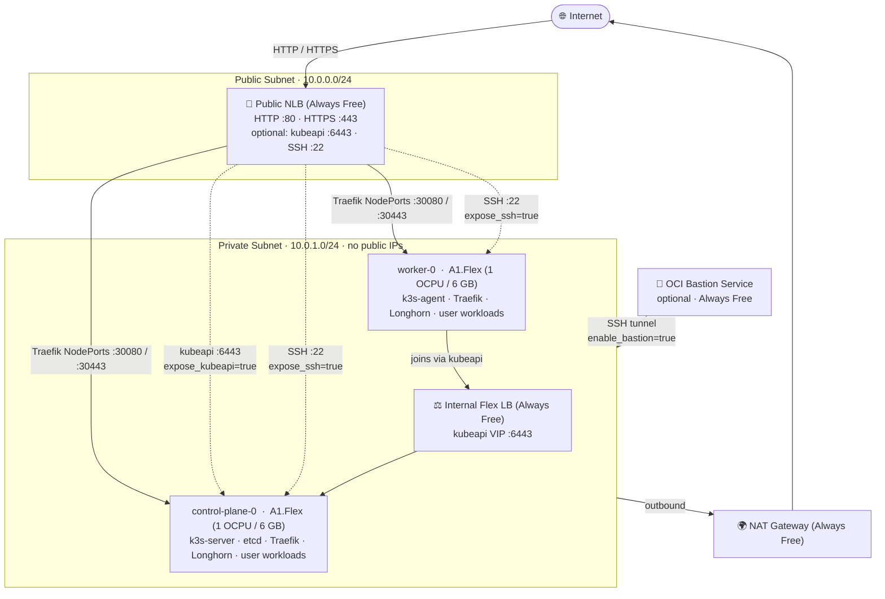

# k3s-oci

[](https://github.com/mbologna/k3s-oci/actions/workflows/ci.yml)

A Terraform/OpenTofu module that builds a [k3s](https://k3s.io) cluster on the [OCI Always Free tier](https://docs.oracle.com/en-us/iaas/Content/FreeTier/freetier_topic-Always_Free_Resources.htm): one control-plane node and one worker on Arm A1.Flex, with ingress, storage, GitOps and backups installed, for $0 a month.

## Features

- **Single control plane**: 1 control-plane node with embedded etcd + 1 standalone worker (OCI Always Free 2 OCPU / 12 GB limit)
- **Full stack always deployed**: cert-manager, Longhorn, ArgoCD, and kured are always installed; they keep the cluster active and prevent [idle reclamation](#-idle-reclamation)
- **Separate public/private subnets**: k3s nodes have no public IP; only LBs and the optional bastion are internet-facing
- **Traefik ingress**: one Traefik pod per node (DaemonSet, upstream chart via ArgoCD) with `system-cluster-critical` priority; standard Kubernetes `Ingress` plus Traefik Middlewares; HTTP→HTTPS redirect and TLS 1.2+ by default; real client IP preservation via NLB transparent mode and `externalTrafficPolicy: Local`
- **Automatic security updates**: `unattended-upgrades` + [kured](https://github.com/kubereboot/kured) drain-reboot-uncordon cycle; zero manual intervention (Ubuntu), `zypper patch` systemd timers (openSUSE Leap), `transactional-update` timers (Leap Immutable), or on Fedora CoreOS an upgrade Plan that rolls the release pinned in git out one drained node at a time
- **Configurable OS** (`os_family`): Ubuntu LTS (default, `ubuntu_version`, OCI-native image auto-resolved) or openSUSE Leap (`opensuse_leap_version`, Minimal VM or Immutable Mode with `opensuse_variant`, custom-imported UEFI image via `scripts/import-opensuse-aarch64.sh`) or Fedora CoreOS (`fcos_os_version`, custom-imported via `scripts/import-fcos-aarch64.sh`); Renovate bumps the releases
- **k3s version pinned at plan time**: resolved from the GitHub API during `terraform plan`, not at boot time
- **Compartment-scoped IAM**: the dynamic group matches instances in the cluster's compartment (tag matching breaks instance_principal for pool members), and the policy grants only narrow verbs (read instances, read only the Vault secrets cloud-init needs, push logs, write objects in the cluster bucket)
- **Idempotent cloud-init**: all `kubectl` operations use `apply`; re-provisioning is safe
- **Direct SSH via NLB** (`expose_ssh = true`): expose port 22 on the public NLB restricted to `my_public_ip_cidr`; eliminates the need for OCI Bastion sessions for day-to-day access
- **OCI Vault** (`enable_vault = true`): cluster secrets in a free software-protected OCI Vault; fetched at boot via instance_principal, not embedded in user-data
- **Boot volume backups** (`enable_backup = true`): weekly full backups, 1-week retention, within the 5-backup Always Free limit
- **etcd snapshots to Object Storage** (`enable_object_storage_state = true`, `enable_etcd_snapshots = true`): a versioned bucket holds the 6-hourly etcd snapshots and the first-server leader lock (not your Terraform state, see [Remote Terraform state](#remote-terraform-state-oci-object-storage))
- **Longhorn backups to Object Storage** (`enable_longhorn_backup = true`): a second versioned bucket; with `create_longhorn_backup_user = true` the module creates a bucket-scoped service user and cloud-init wires the BackupTarget and a daily backup job
- **Rebuild without data loss** (`just teardown-keep-data`): destroys the cluster but keeps the Vault and both buckets, then re-imports them so the next apply reuses them
- **MySQL HeatWave** (`enable_mysql = false`): opt-in Always Free MySQL DB in the private subnet; credentials pre-created as a Kubernetes Secret
- **External DNS** (`enable_external_dns = false`): automatic Cloudflare DNS records for Ingress hosts (see [Deploying a web application](#deploying-a-web-application))
- **External Secrets** (`enable_external_secrets = false`): sync OCI Vault secrets into Kubernetes Secrets via instance_principal; no credentials to rotate. This lets the nodes read every secret in the compartment; `create_external_secrets_user = true` makes the store use a vault-scoped service user instead, so the nodes keep only their boot secrets

## Architecture



Both A1.Flex instances live in a **private subnet** with no public IPs. Internet traffic enters exclusively through two Always Free load balancers.

> **k3s naming note:** k3s calls control-plane nodes "servers" (`k3s server`) and workers "agents" (`k3s agent`). Terraform resources follow k3s conventions (`server`/`worker`); in standard Kubernetes terminology these map to control-plane and worker nodes.

**Public NLB** forwards HTTP/HTTPS directly to Traefik's NodePorts on both nodes. `is_preserve_source = true` preserves real client IPs at the hypervisor level. The NLB optionally exposes the Kubernetes API on port 6443, restricted to your IP.

**Internal Flex LB** provides a stable private VIP for the control-plane node. Workers join via this VIP; the optional public kubeapi listener on the NLB targets the server directly.

**Longhorn** runs on both nodes with `defaultReplicaCount=2`; each PVC is replicated across both nodes. User workloads schedule on both nodes ([Node roles](#node-roles-and-workload-placement)).

The server and worker run in different fault domains (`fault_domains` / `standalone_worker_fault_domain`). Why there are only two nodes and what a single etcd node means: see [Why this topology](#why-this-topology) and [Failure tolerance](#failure-tolerance).

## Quickstart

```bash
# 1. Clone the repo
git clone https://github.com/mbologna/k3s-oci.git
cd k3s-oci

# 2. Copy and edit the variables file
cp example/terraform.tfvars.example example/terraform.tfvars
$EDITOR example/terraform.tfvars

# 3. Init and apply (terraform or tofu both work)
cd example && tofu init && tofu apply
```

To consume the module from your own configuration, pin a release tag; the
[Releases](https://github.com/mbologna/k3s-oci/releases) page lists them with their notes, and
[Versioning](#versioning) says which bumps need changes on your side.
[](https://github.com/mbologna/k3s-oci/releases/latest)

```hcl
module "k3s" {
  source = "github.com/mbologna/k3s-oci?ref=vX.Y.Z" # the latest release tag
  # ... see example/main.tf for the full variable list
}
```

A `Justfile` is included for common operations (requires [just](https://github.com/casey/just)):

```bash
just init        # tofu init in example/
just plan        # tofu plan in example/
just apply       # tofu apply in example/
just kubeconfig  # fetch kubeconfig via OCI Bastion or the NLB (expose_ssh)
just ssh worker  # SSH into a node (server/worker or a private IP)
just fmt         # tofu fmt -recursive
```

## kubeconfig

After `terraform apply`, run:

```bash
terraform output kubeconfig_hint
```

This prints the exact steps for your configuration. If `enable_bastion = true` (recommended), the fastest path is the included helper script:

```bash
cd example && ./get-kubeconfig.sh
export KUBECONFIG=~/.kube/clusters/config_oci_k3s   # override with KUBECONFIG_OUT=...
kubectl get nodes                                   # context: k3s-oci
```

> `enable_bastion` defaults to `true`. It uses OCI Bastion Service, a managed SSH proxy with no VM, no boot volume, and no cost. Without it, nodes are only reachable via OCI serial console (`terraform output kubeconfig_hint` explains all options).

> **Direct SSH (no Bastion):** set `expose_ssh = true` to expose port 22 on the public NLB, restricted to `my_public_ip_cidr`. After apply:
> ```bash
> $(terraform output -raw ssh_command)
> ```
> This is faster than Bastion sessions and avoids session TTLs. When using `expose_ssh = true` you can set `enable_bastion = false` to skip the Bastion Service resource entirely.

### Stable cluster CA across rebuilds

Every `--cluster-init` normally generates a new cluster CA, so kubeconfigs stored elsewhere
(a password manager, dotfiles) stop working after a rebuild. To keep them valid, store the CA
in OCI Vault and set `k3s_ca_vault_secret_id` (requires `enable_vault = true`):

```bash
# export the running cluster's CA (through Bastion or the NLB, like just ssh), so existing
# kubeconfigs keep working, and store it as the Vault secret <cluster_name>-k3s-ca:
CLUSTER_NAME=mycluster VAULT=true just k3s-ca-export
# it prints the line to add to terraform.tfvars:
#   k3s_ca_vault_secret_id = "<secret OCID>"
```

`scripts/k3s-ca-export.sh` also leaves the bundle in `./<cluster_name>-k3s-ca.b64` (mode 600): it
holds the CA private keys, so keep it somewhere safe or delete it. By hand, the bundle is
`sudo tar -czf - -C /var/lib/rancher/k3s/server/tls server-ca.crt server-ca.key client-ca.crt client-ca.key | base64 -w0`
on the server, and the Vault secret's value is that base64 text.

The first server extracts the four files before `--cluster-init`. k3s reuses existing CA files
instead of generating them, so the cluster keeps the same CA. If the secret is set but cannot
be fetched or extracted, cloud-init aborts instead of minting a new CA. Admin client certs
signed by `client-ca` (with `O=system:masters`) then survive rebuilds. The secret is created
outside the module, so `tofu destroy` never deletes it.

Setting it on an existing cluster takes effect at the next full rebuild: instance configurations
ignore `user_data` changes, so a server the pool relaunches meanwhile still boots without it.

## Deploying a web application

### Why TLS is terminated at Traefik, not at the OCI load balancer

OCI provides two load balancer products with very different capabilities:

| | OCI Network Load Balancer (NLB) | OCI Flexible Load Balancer |
|---|---|---|
| OSI layer | **L4 (TCP passthrough)** | L7 (HTTP/HTTPS aware) |
| TLS termination | ❌ Not possible | ✅ Yes |
| Always Free | **1 NLB** | 1 × 10 Mbps |
| Used here | `nlb.tf`: public internet traffic | `lb.tf`: internal kubeapi endpoint |

The public-facing load balancer is the **NLB**. It forwards raw TCP streams with `protocol = "TCP"`, so it has no knowledge of TLS, HTTP headers, or certificates. TLS **must** be terminated by something behind it.

The **Flexible LB** *could* terminate TLS, but the one free allocation is already consumed by the internal kubeapi load balancer. Even if it were available, using OCI to manage certificates would break the automatic cert-manager + Let's Encrypt renewal cycle.

The current flow is: Internet → NLB (TCP passthrough, preserves client IPs) → Traefik NodePort (one pod per node) → TLS terminate → route to app pod.

How Traefik is set up (`gitops/apps/traefik.yaml`):

- **websecure is the default entrypoint.** An Ingress or IngressRoute without an explicit entrypoint is served on :443 only, with TLS.
- **:80 redirects to HTTPS** (permanent), at the lowest router priority, so cert-manager's HTTP-01 solver Ingress (pinned to the `web` entrypoint by the ClusterIssuers) still answers the ACME challenge there. To serve plain HTTP on purpose, pin an Ingress to `web` with the annotation `traefik.ingress.kubernetes.io/router.entrypoints: web`.
- **TLS 1.2+ with AES-GCM ciphers** (TLSOption `default`).
- **No Ingress status**: the NodePort Service has no load-balancer address, and `gitops/` stays IP-free. Argo CD treats an Ingress as Healthy without it; for external-dns, give your Ingress the `external-dns.alpha.kubernetes.io/target: <NLB_IP>` annotation (cloud-init does this for the ArgoCD and Longhorn Ingresses).

### Minimal example: HTTP-only

No domain needed. Requests to the NLB IP are served directly.

```yaml
# hello-web.yaml
apiVersion: apps/v1
kind: Deployment
metadata:
  name: hello-web
  namespace: hello-web
spec:
  replicas: 2
  selector:
    matchLabels:
      app: hello-web
  template:
    metadata:
      labels:
        app: hello-web
    spec:
      topologySpreadConstraints:
        - maxSkew: 1
          topologyKey: kubernetes.io/hostname
          whenUnsatisfiable: DoNotSchedule
          labelSelector:
            matchLabels:
              app: hello-web
      containers:
        - name: hello-web
          image: httpd:alpine
          ports:
            - containerPort: 80
---
apiVersion: v1
kind: Service
metadata:
  name: hello-web
  namespace: hello-web
spec:
  selector:
    app: hello-web
  ports:
    - port: 80
      targetPort: 80
---
# Ingress without a host = matches every request; pinned to the web entrypoint
# (plain HTTP), where it outranks the HTTP->HTTPS redirect.
apiVersion: networking.k8s.io/v1
kind: Ingress
metadata:
  name: hello-web
  namespace: hello-web
  annotations:
    traefik.ingress.kubernetes.io/router.entrypoints: web
spec:
  ingressClassName: traefik
  rules:
    - http:
        paths:
          - path: /
            pathType: Prefix
            backend:
              service:
                name: hello-web
                port:
                  number: 80
```

```bash
kubectl create namespace hello-web
kubectl apply -f hello-web.yaml
NLB_IP=$(cd example && tofu output -raw nlb_ip)
curl http://$NLB_IP/
```

### Minimal example: HTTPS with sslip.io (no domain purchase required)

[sslip.io](https://sslip.io) is a public DNS service that resolves `<anything>.<ip>.sslip.io` directly to `<ip>`. Combined with cert-manager + Let's Encrypt HTTP-01, this gives a trusted TLS certificate with zero infrastructure cost.

Replace `<NLB_IP>` with the value of `tofu output -raw nlb_ip`.

```yaml
# hello-web-tls.yaml
---
# 1. Certificate, issued over HTTP-01 through Traefik's web entrypoint. It lives
#    in the app's namespace: an Ingress can only use a TLS Secret of its own.
apiVersion: cert-manager.io/v1
kind: Certificate
metadata:
  name: hello-web-tls
  namespace: hello-web
spec:
  secretName: hello-web-tls
  issuerRef:
    name: letsencrypt-prod
    kind: ClusterIssuer
  dnsNames:
    - hello-web.<NLB_IP>.sslip.io
---
# 2. Ingress on websecure (the default entrypoint); :80 redirects here already.
apiVersion: networking.k8s.io/v1
kind: Ingress
metadata:
  name: hello-web
  namespace: hello-web
spec:
  ingressClassName: traefik
  tls:
    - hosts:
        - hello-web.<NLB_IP>.sslip.io
      secretName: hello-web-tls
  rules:
    - host: hello-web.<NLB_IP>.sslip.io
      http:
        paths:
          - path: /
            pathType: Prefix
            backend:
              service:
                name: hello-web
                port:
                  number: 80
```

```bash
# Wait for certificate issuance (typically 1-2 minutes)
kubectl wait --for=condition=Ready certificate/hello-web-tls -n hello-web --timeout=5m
curl https://hello-web.<NLB_IP>.sslip.io/
```

Instead of a separate Certificate, you can annotate the Ingress with `cert-manager.io/cluster-issuer: letsencrypt-prod` and let cert-manager's ingress-shim create it from `spec.tls`.

Middlewares (BasicAuth, rate limits, IP allowlists, headers) are Traefik `Middleware` objects attached with `traefik.ingress.kubernetes.io/router.middlewares: <namespace>-<name>@kubernetescrd`; `gitops/argocd/rate-limit.yaml` and `gitops/longhorn/ingress.yaml` show two.

> **With a real domain**: set `enable_external_dns = true` and add the `target` annotation
> described above; External DNS creates the records, then cert-manager issues the certificate.
> `enable_dns01_challenge = true` switches to DNS-01 (wildcard certificates, no inbound port 80).

### DNS: lower ndots for Alpine (musl) images

Pods inherit the node's search domains (the OCI VCN's, plus any a node adds, e.g. Tailscale's)
after the cluster ones. With Kubernetes' default `ndots:5`, an external name such as `github.com`
is first tried against every search domain, and musl gives up when one of those lookups errors
(`EAI_AGAIN`, "DNS server returned general failure") instead of trying the next. Set
`ndots:1` on such workloads, and write in-cluster names fully qualified
(`kubernetes.default.svc.cluster.local`): musl does not apply the search list to a dotted name.

```yaml
spec:
  template:
    spec:
      dnsConfig:
        options:
          - name: ndots
            value: "1"
```

### Resilience: spread replicas across nodes

Run `replicas ≥ 2` with `topologySpreadConstraints` on `kubernetes.io/hostname` so losing one node never takes all replicas down. Traefik already runs on both nodes, so ingress survives a single-node drain or failure. See [gitops/README.md](gitops/README.md#resilience-spread-replicas-across-nodes) for the snippet and a matching PodDisruptionBudget.

## GitOps, App of Apps

The `gitops/` directory contains ArgoCD `Application` manifests managed with the [App of Apps pattern](https://argo-cd.readthedocs.io/en/stable/operator-manual/cluster-bootstrapping/#app-of-apps-pattern).

After the cluster is running, bootstrap it:

```bash
kubectl apply -n argocd -f gitops/apps/app-of-apps.yaml
```

ArgoCD will then continuously reconcile every manifest under `gitops/apps/`.

### Keeping the Argo CD UI off the internet

By default cloud-init publishes the Argo CD UI on an sslip.io hostname behind the NLB. To reach it only
over your tailnet, set `argocd_hostname = ""` (no public route), deploy the Tailscale operator
(`gitops/tailscale-operator/`), and add a Service like this to your gitops repo. The Longhorn UI works
the same way (selector `app: longhorn-ui`, port 8000); leave `longhorn_hostname` unset.

```yaml
apiVersion: v1
kind: Service
metadata:
  name: argocd-server-tailnet
  namespace: argocd
  annotations:
    tailscale.com/hostname: argocd   # http://argocd.<tailnet>.ts.net
    # tailscale.com/proxy-group: ingress-ha   # with the HA ProxyGroups
spec:
  type: LoadBalancer
  loadBalancerClass: tailscale
  selector:
    app.kubernetes.io/instance: argocd
    app.kubernetes.io/name: argocd-server
  ports:
    - name: http
      port: 80
      targetPort: 8080
```

Plain HTTP is fine inside WireGuard (`server.insecure` is already on). CLI:
`argocd login argocd.<tailnet>.ts.net --plaintext --grpc-web`. The tailscale namespace's
NetworkPolicies let the proxy out; the UI's namespace must let it in: add a
`kubernetes.io/metadata.name: tailscale` namespace selector next to Traefik's in `allow-traefik-ingress`
(`gitops/network-policies/argocd.yaml`, `longhorn-system.yaml`).

### Adding your own applications

This repo is designed to be forked. To add your own apps on top of the built-in stack:

1. **Fork this repo** on GitHub.

2. **Update all `repoURL` references** to point to your fork:
   ```bash
   bash gitops/update-repo-url.sh https://github.com/your-org/your-fork.git
   git add gitops/ && git commit -m "chore: update gitops repoURL"
   git push
   ```

3. **Add your ArgoCD `Application` manifests** to `gitops/apps/`, ArgoCD syncs them automatically. Each app can point at any Helm chart registry or any Git repository.

> **Deploying for the first time?** Also set `gitops_repo_url` in `terraform.tfvars` before running `tofu apply`, so cloud-init writes the correct fork URL at bootstrap:
> ```hcl
> gitops_repo_url = "https://github.com/your-org/your-fork.git"
> ```
> **Already have a running cluster?** Patch the App of Apps directly:
> ```bash
> argocd app set app-of-apps --repo https://github.com/your-org/your-fork.git
> ```

> **Private repos**: two auth methods, both storing the credential in OCI Vault automatically so cloud-init can create the `argocd-repo-gitops` Secret before ArgoCD starts. No manual `argocd repo add` step needed.
>
> - **SSH**: set `gitops_ssh_private_key` with your deploy key.
> - **HTTPS token**: set `gitops_https_username` + `gitops_https_token` (read-only repository scope; ArgoCD never writes). Takes precedence over the SSH key when both are set.
>
> Prefer the HTTPS token if your git host throttles SSH per source IP. ArgoCD is a heavy SSH client, every Application opens its own `git ls-remote`, and the resulting connection bursts can trip such limits and stall GitOps entirely, with apps stuck reporting `sync.revision` as `HEAD` rather than a SHA. Codeberg does this; GitHub and GitLab generally do not.
>
> For repos with a non-standard directory layout, set `gitops_path` (default: `gitops/apps`).
>
> With `enable_external_secrets = true`, cloud-init also creates an `optional-external-secrets` Application that reads
> `external-secrets.yaml` from `gitops_optional_path` (default: `gitops/optional`) in the same repo. If your repo
> manages ESO itself, set `gitops_optional_path = ""`: cloud-init still installs ESO but creates no wrapper.
>
> Repos that wrap Helm charts in kustomize (`helmCharts:` in a `kustomization.yaml`) work out of the box: Argo CD
> starts with `kustomize.buildOptions: --enable-helm`.

## Automatic updates & reboots (unattended-upgrades + kured)

`unattended-upgrades` applies Ubuntu security patches daily and sets `/var/run/reboot-required` when a kernel update needs a reboot.

[kured](https://github.com/kubereboot/kured) checks every node's reboot flags (below) and, when one says a reboot is due:
1. Acquires a cluster-wide lock (only one node reboots at a time)
2. Cordons + drains the node
3. Reboots
4. Waits for the node to return and uncordons it

kured reboots between 02:15 and 04:15 UTC, after the package timers have finished
(`gitops/apps/kured.yaml`), and checks every minute, so the second node follows as soon as the first is
back. A reboot that installs a security fix happens that same night, any day of the week; any other
reboot waits for Tuesday, Wednesday or Thursday. The nodes tell them apart: `security-reboot-check`
(Ubuntu: after each package run and hourly) writes `/run/security-reboot-required` when a package in
`/run/reboot-required.pkgs` came from a `-security` pocket, and on openSUSE the security-only patch run
writes it when its patches need a reboot. kured's sentinel command reboots for that file on any night
and for `/var/run/reboot-required` only Tuesday to Thursday. Every schedule the module creates is in
UTC, so that order cannot change at a daylight-saving switch.

Two guards keep this from stalling on Ubuntu: `apt-daily.service` (the package-list refresh) is killed
after an hour, because a fetch hung for weeks once and quietly stopped all patching; and
`unattended-upgrades.service` restarts with `systemd-logind`, so its shutdown delay lock never outlives
a logind restart and holds up a reboot.

k3s itself is upgraded by system-upgrade-controller, one node at a time, in a nightly window
(23:00-23:59 UTC, `gitops/system-upgrade/plans.yaml`) that ends before every other nightly job. An
upgrade cordons the node and restarts k3s without draining it: running containers stay up across a k3s
restart, and draining only shuffled every pod onto the other node. kured's lock does not cover these
upgrades, so kured is configured to wait while an upgrade Job is running
(`blockingPodSelector: [upgrade.cattle.io/plan]`). kured's lock expires after 2 hours (`lockTtl`), so
a node that dies mid-reboot cannot block every later reboot, and a drain stuck on a
PodDisruptionBudget gives up after 15 minutes and is retried at the next check.

This keeps the cluster patched with no manual intervention, one node at a time. It is not zero-downtime: a reboot's drain restarts every single-replica pod on that node somewhere else, and while the control-plane node reboots the Kubernetes API is down. Run two replicas spread across the nodes ([Resilience](#resilience-spread-replicas-across-nodes)) for anything that must stay up through the nightly window.

## Dependency updates (Renovate)

[Renovate](https://docs.renovatebot.com) tracks Terraform providers, k3s, all stack component versions (via `# renovate:` inline comments in `vars.tf` and `gitops/apps/*.yaml`), and GitHub Actions. Enable it on your fork with the [Renovate GitHub App](https://github.com/apps/renovate); `renovate.json` extends a shared preset you may want to replace with your own.

**k3s** follows the `stable` channel by default, so there is nothing to bump. To pin it instead, put a `version` with a renovate comment directly above it in both Plans (`gitops/system-upgrade/plans.yaml` shows how) and the same release in a committed `example/k3s-version.auto.tfvars` (`git add -f`: `.gitignore` excludes `*.tfvars`, since `terraform.tfvars` holds secrets):

```hcl
# renovate: datasource=github-releases depName=k3s-io/k3s
k3s_version = "v1.36.6+k3s1"
```

Renovate then updates both in one `k3s` PR:

| Update | What happens |
|---|---|
| Patch (`v1.36.6` → `v1.36.7`) | Automerges after the preset's 7-day gate, in its own PR, so a waiting minor never absorbs a patch for the running minor |
| Minor, new version `x.y.0`–`x.y.2` | No PR: a new minor is taken only from its third patch, once the first regressions are fixed |
| Minor, new version `x.y.3` or later | Automerges after the 14-day gate; system-upgrade-controller applies it in the next upgrade window |
| Major | Waits for a person (`manual-review`) |

**OS releases** come from [endoflife.date](https://endoflife.date) (Ubuntu), [openSUSE's release API](https://get.opensuse.org/api/v0/distributions.json) (Leap) and [Fedora CoreOS's stable stream](https://builds.coreos.fedoraproject.org/streams/stable.json) and arrive as PRs that automerge after CI; the OS release bumps are `feat(os):`, so each one ships in a release:

| Release | Bump | After it merges |
|---|---|---|
| Ubuntu (`ubuntu_version`) | Next LTS (`xx.04` of an even year, never interim releases), once its `.1` point release is out, when Ubuntu itself opens LTS-to-LTS upgrades (and at least 90 days after release). The required Plan check fails the PR if OCI has no aarch64 image for it yet | The next full rebuild (`tofu destroy` + `apply`, or `just teardown-keep-data`) boots the new release. Until then nothing changes: the instance configurations ignore image changes, so running nodes and pool replacements keep the image the pool was created with |
| openSUSE Leap (`opensuse_leap_version` and the import script's default, one PR) | Next Leap release, as soon as openSUSE marks it Stable (the legacy `42.x` numbering is ignored) | Run `scripts/import-opensuse-aarch64.sh` (with `--variant immutable` for Leap Immutable); the next full rebuild then boots the new release without `os_image_id`. Until it is imported, plans warn and a rebuild boots the newest imported image |
| Fedora CoreOS major (`fcos_version`, the boot image) | The stable stream's new major | Run `scripts/import-fcos-aarch64.sh`. Until then plans warn and new nodes boot the newest imported image; either way they pivot to `fcos_os_version` before k3s starts |
| Fedora CoreOS release (`fcos_os_version` and the `fcos-os` Plan's `version`, one PR) | Every new stable release (about every two weeks) | The `fcos-os` Plan updates the FCOS nodes in its next window (Tue-Thu 02:15-04:15 UTC), one drained node at a time along the update graph; new nodes pivot to it on first boot |

### CI plan against a live deployment

`.github/workflows/plan.yml` runs `tofu plan` of `example/` against a live deployment on every same-repository pull request, read-only: an empty plan shows that a provider or chart bump changes nothing in the tenancy. It needs the deployment's state in a remote backend ([Remote Terraform state](#remote-terraform-state-oci-object-storage)) and its own OCI user that may only read. Only the addresses of changed resources reach the log, since the full plan holds OCIDs, IP addresses and tfvars values. Until the secrets below exist, the job reports a notice and succeeds, so fork pull requests (which get no secrets) are not blocked.

To set it up:

1. **Group and policy** (Identity → Domains → Default → Groups, then Policies, in the root compartment):

   ```text
   Group:  k3s-oci-plan
   Policy: tofu-plan-readers
     Allow group k3s-oci-plan to read all-resources in tenancy where all {request.permission != 'SECRET_BUNDLE_READ', request.permission != 'OBJECT_READ'}
     Allow group k3s-oci-plan to read objects in tenancy where target.bucket.name = '<state bucket>'
   ```

   The first statement lets the plan refresh every resource without reading secret contents or the etcd snapshots and Longhorn backups in the module's buckets; the second reads the state object only. The state holds every cluster secret, so treat these credentials like the state itself.
2. **User** `k3s-oci-plan` (no console password), member of `k3s-oci-plan`, with an API key (Users → API keys → Add) and a customer secret key (Users → Customer secret keys) for the S3-compatible state backend.
3. **GitHub secrets** (Settings → Secrets and variables → Actions):

   | Secret | Value |
   |---|---|
   | `OCI_PLAN_USER_OCID`, `OCI_PLAN_FINGERPRINT`, `OCI_PLAN_TENANCY_OCID`, `OCI_PLAN_REGION` | the API key's config snippet |
   | `OCI_PLAN_PRIVATE_KEY` | the API key's private key (PEM) |
   | `PLAN_STATE_ACCESS_KEY_ID`, `PLAN_STATE_SECRET_ACCESS_KEY` | the customer secret key |
   | `PLAN_BACKEND_OVERRIDE` | your `example/backend_override.tf`; the job overrides its `profile` with its own |
   | `PLAN_TFVARS` | your `example/terraform.tfvars` followed by any `*.auto.tfvars`, the inputs the deployment was applied with; set it again after changing them (`cat terraform.tfvars *.auto.tfvars \| gh secret set PLAN_TFVARS`). If your tfvars point at the SSH key with `public_key_path` (the default, `~/.ssh/id_ed25519.pub`), append `public_key = "<that key>"`: the runner has no such file, and the key must be the one the deployment was built with, or the plan shows the instances changing |

4. Add `Plan / tofu plan (example)` to the `main` ruleset's required checks, so a pull request whose plan changes resources can't merge (a plan that only changes root outputs passes).

In this repository the job is a required check, so Terraform provider updates automerge once their plan is empty. On a fork, set it up before relying on that: without its secrets it reports a notice and succeeds, so a provider update would automerge unplanned.

## Versioning

Releases follow SemVer: [auto-release](https://github.com/mbologna/auto-release) tags `vX.Y.Z` from the Conventional Commit types (`feat` minor; `fix`, `perf`, `revert` patch; a breaking change major) and publishes a GitHub release; you consume one as `?ref=vX.Y.Z`. A major is what may need changes on your side: a removed or renamed variable, or a change that forces resources of an existing deployment to be replaced. An OS release bump (`feat(os)`, above) is a minor, since it reaches nodes only at the next full rebuild. k3s follows its channel (`stable` by default), so tags carry no k3s version. See the [versioning standard](https://github.com/mbologna/.github/blob/main/VERSIONING.md).

## Remote Terraform state (OCI Object Storage)

`enable_object_storage_state = true` (the default) creates the versioned `<cluster_name>-terraform-state`
bucket. **It holds etcd snapshots and the leader lock, do not store your Terraform state in it:**

- The nodes have `manage objects` on that bucket, and the state contains every cluster secret
  (k3s token, Longhorn UI password, OAuth secrets, …). A compromised node could read it.
- `scripts/clean-oci-resources.sh` and `tofu destroy` delete the bucket together with the cluster.

Keep the state in a separate bucket, created outside this module, that the nodes have no IAM grant on:

```bash
oci os bucket create -c <compartment_ocid> --name <cluster_name>-tofu-state \
  --versioning Enabled --public-access-type NoPublicAccess
```

Then point the S3 backend at it from a gitignored `backend_override.tf` next to your module call
(`*_override.tf` is already in this repo's `.gitignore`); `example/backend_override.tf.example` is a
copy to start from:

```hcl
terraform {
  backend "s3" {
    bucket                      = "<cluster_name>-tofu-state"
    key                         = "terraform.tfstate"
    region                      = "<your-region>"                     # e.g. eu-frankfurt-1
    profile                     = "oci-tofu-state"                    # ~/.aws/credentials
    endpoints                   = { s3 = "https://<namespace>.compat.objectstorage.<region>.oraclecloud.com" }
    use_path_style              = true
    use_lockfile                = true                                # OpenTofu >= 1.10 / Terraform >= 1.11
    skip_region_validation      = true
    skip_credentials_validation = true
    skip_requesting_account_id  = true
    skip_metadata_api_check     = true
    skip_s3_checksum            = true
  }
}
```

Migrate an existing local state with `tofu init -migrate-state`, then check that `tofu plan` reports no changes.
The namespace is in `terraform output terraform_state_backend`.

> **S3 credentials are OCI Customer Secret Keys** (**Identity → Users → <user> → Customer Secret Keys**).
> A key is **not** scoped to a bucket: it carries every permission of the user it belongs to. A key that
> only lives on your laptop can belong to your own user; a key stored *inside* the cluster must belong
> to a service user limited to one bucket, which [Longhorn backups](#longhorn-backups) can create for you.
> New keys take about 5 minutes to work on the S3 endpoint.

## Longhorn backups

`enable_longhorn_backup = true` (the default) creates the `<cluster_name>-longhorn-backup` bucket.
Set `create_longhorn_backup_user = true` to wire backups end to end:

- The module creates an IAM user, a group and a policy, all named `<cluster_name>-longhorn-backup`. The policy
  allows only `read buckets` and `manage objects` on the backup bucket. The user can use Customer Secret
  Keys and nothing else.
- Terraform creates the user's Customer Secret Key. With `enable_vault = true` the secret half is
  stored in Vault as `<cluster_name>-longhorn-backup-secret-key` and fetched at boot, so it is never in user-data.
- Cloud-init creates `longhorn-backup-secret` and points the Longhorn `BackupTarget` at the bucket. It also
  applies the `daily-backup` RecurringJob to every volume in the `default` group: cron `longhorn_backup_schedule`,
  default `30 0 * * *` UTC; keeps `longhorn_backup_retain` backups, default 7.
  There is no snapshot-cleanup job: Longhorn removes system-generated snapshots and each backup's snapshot
  itself. Clusters built by earlier module versions have a `weekly-snapshot-cleanup` job that fails every week on detached
  volumes; delete it with `kubectl -n longhorn-system delete recurringjob weekly-snapshot-cleanup`.

Creating IAM users requires tenancy-level IAM permissions. Without them, keep `create_longhorn_backup_user = false`
and follow the `longhorn_backup_setup` output (or `just setup-longhorn-backup`).
`retain` is the only cleanup: do not add an age-based lifecycle rule on `backupstore/`. Expiring blocks
underneath Longhorn corrupts the incremental chain. Backups of deleted volumes are never pruned automatically.
Delete them in the Longhorn UI.

Nothing reports a backup that stopped running unless you enable `gitops/backup-monitor/`: a daily
CronJob that alerts through an [Apprise API](https://github.com/caronc/apprise-api) server when the
BackupTarget is unavailable, a volume has no backup in 36 hours, or the newest etcd snapshot upload is
older than 13 hours. Setup steps are in its `application-template.yaml`.

## Always Free budget

| Resource | Free allowance | This module |
|---|---|---|
| A1.Flex compute | 2 OCPUs / 12 GB / 2 instances | 1 server + 1 worker = **2 OCPUs / 12 GB** |
| Block storage | 200 GB | 2 × 100 GB = **200 GB** (boot volume IOPS scale with size, the full allowance goes to etcd/image/Longhorn IO) |
| Network Load Balancer | 1 NLB | **1** (public, HTTP/HTTPS) |
| Flexible Load Balancer | 1 × 10 Mbps | **1** (private, kubeapi). Tenancies created before December 2020 may be billed for it: check the cost report after the first apply |
| E2.1.Micro instances | 2 | **0** (bastion uses OCI Bastion Service, managed, no VM) |
| NAT Gateway | 1 per VCN | **1** (outbound-only for private nodes) |
| Object Storage | 20 GB (Free Tier) / 10 GB (Pay As You Go) | **2 versioned buckets**: etcd snapshots + leader lock, and Longhorn PVC backups (`enable_object_storage_state`, `enable_longhorn_backup`) |
| Vault (shared) | Software keys + 150 secrets | **2-10 secrets** (`enable_vault = true`), see [OCI Vault secrets](#oci-vault-secrets) |
| Volume backups | 5 total | **2** (one per node, weekly, 1-week retention) (`enable_backup = true`) |
| MySQL HeatWave | 1 standalone DB, 50 GB | **1 DB system** in private subnet (`enable_mysql = false`, opt-in) |
| Budgets | Free | **1 budget** on the tenancy, emails at 50% and 100% spent and 100% forecast (`budget_alert_email`, opt-in) |

### Spend alert

An Always Free deployment costs nothing, so any spend means something left the free allowance (a
Pay As You Go tenancy over the 10 GB Object Storage limit, a resized shape, a leftover resource).
Set `budget_alert_email` and the module creates an OCI budget on the whole tenancy, `budget_amount`
(default 1, in the tenancy's billing currency) per month, with email alerts at 50% and 100% of actual
spend and at 100% of the month's forecast. Budgets are free and only alert; they never stop anything.
The budget lives in the root compartment, so the user running `tofu apply` needs
`manage usage-budgets in tenancy`.

### OCI Vault secrets

With `enable_vault = true` every cluster secret below lives in the Vault and nodes fetch it
at boot (instance_principal); with `enable_vault = false` it is passed in user-data instead.
The nodes' IAM policy covers only these boot secrets (plus `k3s_ca_vault_secret_id`), unless an
instance_principal External Secrets store needs the whole compartment (see `external_secrets_instance_principal`;
`create_external_secrets_user = true` avoids that with a service user that reads only this vault).

| Secret name | Created when |
|---|---|
| `<cluster>-k3s-token` | always |
| `<cluster>-longhorn-ui-password` | always |
| `<cluster>-dockerhub-password` | `dockerhub_password` set |
| `<cluster>-gitops-ssh-key` | `gitops_ssh_private_key` set |
| `<cluster>-gitops-https-token` | `gitops_https_token` set |
| `<cluster>-cloudflare-api-token` | `cloudflare_api_token` set |
| `<cluster>-tailscale-oauth-client-id` | `enable_tailscale = true` |
| `<cluster>-tailscale-client-secret` | `enable_tailscale = true` |
| `<cluster>-longhorn-backup-secret-key` | `create_longhorn_backup_user = true` or `user_ocid` set |
| `<cluster>-external-secrets-api-key` | `create_external_secrets_user = true` |

`k3s_ca_vault_secret_id` points at a secret you create yourself (not module-managed); see
[Stable cluster CA across rebuilds](#stable-cluster-ca-across-rebuilds).

> ⚠️ **Idle reclamation** <a name="-idle-reclamation"></a>: OCI reclaims Always Free instances where CPU, network, and memory stay below 20% for 7 consecutive days. The full stack (Longhorn, ArgoCD, cert-manager, kured) generates enough background activity to keep the cluster alive.

## Failure tolerance

| Component | Tolerance | What happens on failure |
|---|---|---|
| **Worker node failure** | ⚠️ Partial | Workloads reschedule to the control plane *if their CPU/memory requests fit* in what it has left after k3s itself and etcd; the rest wait Pending until the worker returns. Longhorn (2 replicas) keeps storage up. Keep the control plane's requests well under its allocatable if you need the worker's workloads to fit there |
| **Control-plane failure** | ❌ None | Single etcd node, cluster becomes unavailable; restore from etcd snapshot |
| **HTTP/HTTPS ingress** | ✅ Worker loss | Traefik DaemonSet on control-plane keeps ingress up |
| **Kubernetes API** | ❌ CP loss | Single control-plane; ILB has no failover target |
| **PVC data (Longhorn)** | ✅ 1 node | 2 replicas across 2 nodes; 1 replica lost, 1 remains serving |
| **cert-manager** | ⚠️ Soft | Pod reschedules within minutes; TLS serving unaffected (certs live in Secrets); only new issuance/renewal is paused |
| **Planned reboots / k3s upgrades** | ⚠️ Brief | One node at a time; see [Automatic updates](#automatic-updates--reboots-unattended-upgrades--kured). A node left cordoned after a failed upgrade is not reported unless you enable `gitops/node-cordon-alert/` |
| **ArgoCD** | ⚠️ Soft | GitOps sync pauses until rescheduled; running workloads unaffected |
| **MySQL (if enabled)** | ❌ None | Always Free tier = single OCI-managed instance; no HA failover |

## Node roles and workload placement

Each A1.Flex instance has identical resources (1 OCPU / 6 GB RAM). The k3s role (server vs agent) affects which system processes run, not how much resource is available for workloads.

| What | control-plane-0 | worker-0 | Scheduling mechanism |
|---|:---:|:---:|---|
| **etcd** | ✅ | ❌ | k3s built-in; servers only |
| **Kubernetes API server** | ✅ | ❌ | k3s built-in; servers only |
| **Traefik** (ingress) | ✅ | ✅ | DaemonSet (1 pod per node) |
| **Longhorn** (storage daemon) | ✅ | ✅ | DaemonSet (1 pod per node) |
| **cert-manager**, **External Secrets**, **Tailscale operator** | ✅ | ✅ | Deployments: prefer the worker, run on the control plane while it is drained |
| **ArgoCD** | ✅ | ✅ | `argocd-server`: one replica per node. Controller, redis, notifications, applicationset, repo-server: prefer the worker. Dex is off (no SSO) |
| **kured** | ✅ | ✅ | DaemonSet (1 pod per node) |
| **User workloads** | ✅ | ✅ | No restrictions, schedules on both nodes |

> **Why control-plane runs user workloads:** with one worker, a tainted server would make that worker a single point of failure for every workload. k3s does not taint servers by default; cloud-init still removes any `control-plane`/`etcd` `NoSchedule` taint defensively. Keep IO-heavy batch jobs (CI runners, Renovate, image builds) off the server with a **required** `node-role.kubernetes.io/control-plane DoesNotExist` node affinity: they slow etcd's fsync on the shared boot volume. Give them `priorityClassName: worker-pinned` (`gitops/priority-classes/`) too: after a drain of the control plane its pods sit on the worker and fill its CPU requests, and the class lets a worker-pinned pod preempt them instead of waiting Pending.
>
> **Pods go back where they prefer:** nothing moves a pod once it is running, so after kured drains the worker, the pods that prefer it stay on the control plane. A nightly descheduler run (04:30 UTC, `gitops/apps/descheduler.yaml`) evicts a pod that sits off its preferred node when it fits there, and does nothing else.

### Memory budget (measured)

The control plane runs out of memory long before CPU, so the module's small controllers prefer the worker (table above). Measured on a cluster built from this module (2 nodes, ~60 pods, about 40 Argo CD Applications), November 2026:

| | Control plane | Worker |
|---|---|---|
| k3s process (`k3s.service` / `k3s-agent.service` memory, peak since boot) | 2.2 GiB (2.4; up to 2.9 right after a k3s upgrade) | 0.5–0.65 GiB (0.86) |
| `system-reserved` (kubelet) | 3 GiB, 150m CPU | 1280 MiB, 100m CPU |
| Allocatable | 2.5 GiB, 850m | 4.2 GiB, 900m |
| Pods' working set, controllers on the control plane | 1.4 GiB | 1.1 GiB |
| Pods' working set, controllers on the worker | 1.05 GiB | 2.1 GiB |
| Memory requests, controllers on the worker | 38% | 43% |
| CPU use (`kubectl top`) | ~20% | ~12% |

`system-reserved` covers the k3s process because every pod's containerd-shim is charged to its unit, which is why it is larger on the server. With the controllers on the control plane its node had ~2.1 GiB available; after the move, ~2.4 GiB. Keep pods' memory requests at what they really use (the scheduler sees only requests), and measure before adding anything big to the control plane: `systemctl show k3s -p MemoryCurrent -p MemoryPeak`, `kubectl top nodes`, and `kubectl describe node` for allocated requests.

## Why this topology

OCI reduced the A1.Flex Always Free allocation in June 2026 from 4 OCPUs/24 GB to **2 OCPUs/12 GB** (max 2 instances). The result is 1 control-plane + 1 standalone worker, no etcd HA, but full use of the free allocation.

### Topology comparison

| Topology | etcd HA | Nodes for workloads | Effective RAM for workloads† | Assessment |
|---|:---:|:---:|:---:|---|
| **1 CP + 1 worker (this module)** | ❌ Single node | 2 (taints removed) | ~10 GB | **Only viable option** within 2 OCPU / 12 GB Always Free limit |
| 2 CP + 0 workers | ❌ 2-node etcd invalid | 2 | ~9 GB | 2-node etcd cannot form quorum; worse than 1 node |

†etcd + kubeapi consume ~300-500 MB RAM and ~100-200m CPU per control-plane node.

### Why not use the 2 free E2.1.Micro instances as extra workers?

Always Free also includes 2 AMD E2.1.Micro instances. They are not worth adding:

1. **1 GB RAM**: k3s agent + Longhorn DaemonSet alone consume ~700-800 MB, leaving ~200 MB for user workloads
2. **1/8 OCPU**: negligible compute; adds operational complexity for near-zero workload benefit

### Previously rejected alternatives

| Alternative | Why it was rejected |
|---|---|
| nginx stream proxy in front of Traefik | Extra latency and complexity; NLB already preserves source IPs directly |
| OCI Bastion VM (E2.1.Micro) | OCI Bastion Service provides managed SSH proxying for free with no VM, no OS to patch, and no boot volume consuming storage budget |
| Boot volumes < 50 GB | OCI hard minimum is 50 GB per shape; the default 2 × 100 GB uses the whole 200 GB free block storage allowance |
| Additional NLB for kubeapi | Only 1 NLB is Always Free; the existing NLB conditionally exposes port 6443 via `expose_kubeapi = true` |

### Choosing an OS

The module supports three OS families, selected via `os_family`:

| `os_family` | Image | Auto-resolved | SSH user | Auto-updates |
|---|---|---|---|---|
| `"ubuntu"` (default) | Ubuntu LTS aarch64, release in `ubuntu_version` | ✅ Yes (latest OCI-native image) | `ubuntu` | `unattended-upgrades` + `needrestart` |
| `"opensuse"` | openSUSE Leap Minimal VM aarch64, release in `opensuse_leap_version` | ✅ Yes, once imported (newest image of the release imported with the script) | `sles` | `zypper patch` systemd timers |
| `"fcos"` | Fedora CoreOS aarch64 (image-based, Ignition), boot image major in `fcos_version`, running release in `fcos_os_version` | ✅ Yes, once imported with `scripts/import-fcos-aarch64.sh` | `core` | OpenShift-style: an upgrade Plan rolls the pinned release out, one drained node at a time |
| `"opensuse"` + `opensuse_variant = "immutable"` | openSUSE Leap Immutable Mode aarch64 (read-only root), release in `opensuse_leap_version` | ✅ Yes, once imported with `--variant immutable` | `sles` | `transactional-update` systemd timers |

Renovate bumps both releases ([Dependency updates](#dependency-updates-renovate)).

#### Ubuntu (default)

No extra steps needed. The latest image of the `ubuntu_version` LTS release for `VM.Standard.A1.Flex` is resolved automatically at plan time from the tenancy.

#### openSUSE Leap

OCI has no native openSUSE image. Use the included script to import one before running `tofu apply`:

```bash
./scripts/import-opensuse-aarch64.sh
```

The script:
1. Resolves the latest openSUSE Leap Minimal VM Cloud aarch64 QCOW2 of the release (default: the script's `LEAP_VERSION`, kept equal to `opensuse_leap_version`) from `download.opensuse.org`
2. Streams the image (~271 MiB) directly into a temporary OCI Object Storage bucket, no local disk required
3. Imports via the OCI REST API with `firmware: UEFI_64` and `launchMode: CUSTOM`
   (the OCI CLI's `oci compute image import` always defaults to BIOS; `UEFI_64` is required for `VM.Standard.A1.Flex`),
   recording `openSUSE Leap` and the release as the image's OS and OS version
4. Adds `VM.Standard.A1.Flex` shape compatibility
5. Cleans up the temp Object Storage object
6. Prints the image OCID (the module does not need it; see below)

Then set in `terraform.tfvars`:

```hcl
os_family = "opensuse"
# Only when you imported with --compartment-id outside the tenancy root:
# opensuse_image_compartment_ocid = "ocid1.compartment.oc1..."
```

The module finds the image by itself: it lists the images whose OS is `openSUSE Leap` and takes the
newest one of `opensuse_leap_version`. If that release isn't imported yet, it takes the newest
imported image of any release and plans warn. Set `os_image_id` only to pin one image. Images
imported by older versions of the script have no OS recorded: re-run the script with the same
`--leap-version` (and `--image-name`, if you used one) and it records the OS on the existing image.

**Script options:**

```
--compartment-id OCID   Compartment OCID (default: tenancy root)
--region REGION         OCI region (default: from ~/.oci/config)
--leap-version VERSION  openSUSE Leap version (default: LEAP_VERSION in the script)
--variant VARIANT       minimal (default) or immutable (Leap Immutable Mode, see below)
--bucket-name NAME      Temp bucket name (default: opensuse-image-import-tmp)
--keep-bucket           Do not delete the QCOW2 object after import
--image-name NAME       Custom display name for the imported image
```

**Prerequisites:** OCI CLI configured (`~/.oci/config`), `curl`, `python3`.

**Known caveats (verified with Leap 16.0 + VM.Standard.A1.Flex):**

| Caveat | Detail |
|---|---|
| **Image must be re-imported on new Leap releases** | The image is a custom import, so no update reaches it by itself. When Renovate bumps `opensuse_leap_version`, a rebuild keeps booting the newest imported image and plans warn (`opensuse_image_matches_leap_version`) until you run the script for the new release. For a newer build of the same release, import it under a new `--image-name`: the newest import wins |
| **UEFI_64 required at import time** | OCI's `oci compute image import` CLI hard-codes `firmware: BIOS`. The script works around this via a direct REST API call |
| **Shape compatibility not auto-detected** | OCI does not auto-detect the architecture of imported QCOW2 images; the script adds `VM.Standard.A1.Flex` explicitly |
| **Oracle Cloud Agent (OCA) unavailable** | No OCI-native monitoring agent on custom images |

#### openSUSE Leap Immutable

Leap's Immutable Mode (the successor of Leap Micro) has a read-only root filesystem: packages
go into a new btrfs snapshot with `transactional-update` and are active after the next reboot,
and a failed update leaves the running snapshot untouched. Import it and select it:

```bash
./scripts/import-opensuse-aarch64.sh --variant immutable
```

```hcl
os_family          = "opensuse"
opensuse_variant   = "immutable"
enable_oci_logging = false # custom images have no Oracle Cloud Agent
```

The image is recorded with OS `openSUSE Leap Immutable`, so both variants can be imported side by
side. What differs from the Minimal image:

- **Each node reboots once during its first boot.** cloud-init installs what the image lacks (jq, tar,
  open-iscsi, nfs-client, cronie, k3s-selinux) into a new snapshot and reboots; the systemd unit
  `k3s-oci-bootstrap.service` then runs the same script again, which installs k3s, and disables
  itself when the script completes. The first boot's log is `/var/log/k3s-cloud-init.phase1.log`;
  if the second phase fails, the unit stays enabled and the next boot retries.
- **Updates** run on the same schedule as on Leap Minimal: `tu-security-patch.timer` (daily,
  `zypper patch --category security`) and `tu-full-patch.timer` (Tue-Thu), each into a new snapshot.
  When a snapshot is waiting, they write kured's sentinels, and kured reboots the node in its window.
  The image's own `transactional-update.timer` and `rebootmgr` are disabled.

#### Fedora CoreOS

Fedora CoreOS is image-based. The module runs it the way OpenShift runs its CoreOS nodes: the
cluster decides which OS release the nodes run, and an in-cluster controller rolls it out. Zincati,
FCOS's own updater, is masked. Import the boot image, then select it:

```bash
./scripts/import-fcos-aarch64.sh            # current stable build (--stream testing|next)
```

```hcl
os_family                   = "fcos"
enable_object_storage_state = true  # required (the default)
region                      = "eu-frankfurt-1" # required
enable_oci_logging          = false # custom images have no Oracle Cloud Agent
```

How it differs from the cloud-init OSes:

- **Ignition, with the script in Object Storage.** FCOS reads only Ignition, and OCI's 32,000-byte
  metadata limit is too small for the node script inside an Ignition config. The module uploads the
  script to the `<cluster>-terraform-state` bucket and puts a read-only pre-authenticated request URL
  for it in a small Ignition config, as OpenShift's pointer Ignition config fetches the real one.
  Anyone with that URL can read what user-data holds on other OSes (the shared SSH host key, and the
  cluster secrets if `enable_vault = false`).
- **First boot pivots to the cluster's release** (OpenShift's firstboot pivot). The imported image
  (`fcos_version`) is only a starting point: before k3s starts, the node rebases to `fcos_os_version`
  along FCOS's update graph, one release per reboot when barrier releases lie in between, with
  k3s-selinux, python3 (for the OCI CLI) and cronie layered on the first hop.
- **OS updates are a cluster operation.** The release is pinned in `gitops/fcos-os/plan.yaml` (OpenShift's
  `osImageURL`); Renovate bumps it together with `fcos_os_version` when the stable stream moves. The
  `fcos-os` system-upgrade-controller Plan, added by the first server, rolls it out like OpenShift's
  Machine Config Daemon: in kured's window (Tue-Thu 02:15-04:15 UTC), one node at a time, cordoned and
  drained, then rebased onto the release's image (pinned by digest) and rebooted, through barrier
  releases first. OS reboots never overlap a k3s upgrade: on a node the Plans are `exclusive`
  (system-upgrade-controller keeps their jobs apart), and across nodes their windows don't
  overlap (k3s upgrades start at 23:00-23:59 UTC). kured stays installed and stands down while the Plan's job runs.
- **SSH** as `core`, with the keys from the instance's `ssh_authorized_keys` (Afterburn).
- **Longhorn**: the bootstrap adds a SELinux module that lets Fedora's iscsid log in to Longhorn's
  targets ([Longhorn KB](https://longhorn.io/kb/troubleshooting-volume-attachment-fails-due-to-selinux-denials/)).

#### Using any other OS image

Set `os_image_id` to the OCID of any OCI image. **Only Ubuntu, openSUSE and Fedora CoreOS are tested.** Any other OS will need its own bootstrap logic, fork the repo and adapt `files/lib/bootstrap-ubuntu.sh` as a starting point.

## Teardown

To delete the cluster and all associated OCI resources:

```bash
cd example
tofu destroy
```

> **Buckets:** `<cluster>-terraform-state` (etcd snapshots) and `<cluster>-longhorn-backup` (Longhorn backups)
> are module resources. OCI refuses to delete a non-empty bucket, so `tofu destroy` fails on them while they hold data.
> `scripts/clean-oci-resources.sh` empties and deletes them.
>
> **To rebuild without losing snapshots and backups**, use `scripts/teardown-keep-data.sh` instead of `tofu destroy`.
> It keeps the vault, its key and secrets, and both buckets, and puts them back into the state afterwards:
>
> ```bash
> COMPARTMENT_OCID=ocid1.tenancy.oc1..xxx CLUSTER_NAME=mycluster just teardown-keep-data
> # TF_DIR=path/to/root-module, CLEAN_CMD="bash my-wrapper.sh" optional;
> # IMPORT_ONLY=true resumes after a failed re-import;
> # PRE_BACKUP=true first takes a fresh etcd snapshot and Longhorn backups (just pre-teardown-backup)
> just apply
> ```
>
> The script runs `state rm` on the kept resources, then `tofu destroy`, then the clean script with
> `KEEP_VAULT=true KEEP_BUCKETS=true`. Then it cancels pending vault and secret deletions and re-imports everything.
> Keep your Terraform state in a separate, module-external bucket (see [Remote Terraform state](#remote-terraform-state-oci-object-storage)) so teardown never touches it.

### After a rebuild that kept the buckets

- **Expected warning:** the new server finds the old cluster's etcd snapshots and logs
  `WARNING: etcd snapshots from a previous '<cluster>' cluster exist in ...` with the `k3s server --cluster-reset --cluster-reset-restore-path`
  restore steps. If you meant to start fresh, ignore it.
- **Restore window:** pruning keeps the newest `etcd_snapshot_retention` objects across the whole
  `etcd-snapshots/<cluster>/` prefix, so the new cluster's uploads push the old ones out. That takes
  `etcd_snapshot_retention` uploads, about 30 hours at the default retention of 5 and 6 hours between uploads.
  If you might need the old cluster's state later, copy its snapshots outside that prefix first
  (e.g. `oci os object copy` to `etcd-archive/`; it counts against the Object Storage allowance).
- **Longhorn backups** are not pruned by the new cluster. Once Argo CD has synced the apps,
  `just longhorn-restore` restores every Longhorn PVC from its newest backup (it skips volumes
  newer than their backup, so it never rolls a live volume back) and rebinds the PVC; pods using
  it restart. By hand: the Longhorn UI (**Backup → select → Restore**), or a `Volume` with `spec.fromBackup` set.

## NLB IP stability

The public NLB is never replaced by an ordinary `tofu apply`, so its IP is stable across applies.
It has `prevent_destroy = false` (so `tofu destroy` works for full rebuilds); if the NLB is **ever recreated** (destroy + apply, or `tofu state rm` + re-apply):

- All `sslip.io` hostnames change (e.g. `argocd.<old-ip>.sslip.io` → `argocd.<new-ip>.sslip.io`)
- Let's Encrypt certificates are invalid for the new hostnames and must be reissued
- With a custom domain + `enable_external_dns = true`, ExternalDNS updates DNS automatically and cert-manager auto-renews

**If using sslip.io defaults**, run `tofu apply` again after NLB recreation: `local.argocd_hostname` recomputes automatically from the new IP, cloud-init re-creates the Ingresses and certificates, and cert-manager reissues via Let's Encrypt.

## Why not an existing tool

- [terraform-oci-oke](https://github.com/oracle-terraform-modules/terraform-oci-oke) (Oracle's module for OKE, its managed Kubernetes) builds OKE, not k3s, so it has no etcd snapshot uploads.
- It also leaves out the rest of this stack: no Longhorn with its backup target, no OCI Vault and External Secrets wiring, no Tailscale bootstrap, no Traefik behind the NLB with client IPs kept, and no rebuild that keeps data.
- [garutilorenzo/k3s-oci-cluster](https://github.com/garutilorenzo/k3s-oci-cluster) (a k3s module for OCI) has had no push since July 2025.

Checked 2026-11-23.

## License

MIT. See [LICENSE](LICENSE).

## Variables

<!-- BEGIN_TF_DOCS -->
_Auto-generated input/output reference is disabled for now (the CI job that kept it in sync can no longer push to this branch-protected main). Run `terraform-docs -c .terraform-docs.yml .` locally to regenerate, or see `variables.tf` / `output.tf` for the current source of truth._
<!-- END_TF_DOCS -->
